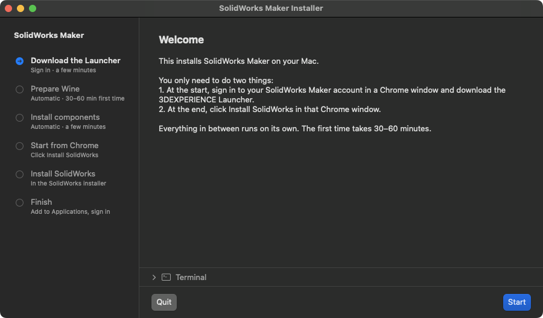

# SOLIDWORKS Maker on Mac

Run SOLIDWORKS for Makers on macOS with Wine.
Supports both Apple Silicon and Intel Macs.


## Install

Paste this into Terminal:

```sh
curl -fsSL https://raw.githubusercontent.com/lazy-jubei/solidworks-maker-mac/main/install.sh -o /tmp/solidworks-maker-install.sh && zsh /tmp/solidworks-maker-install.sh
```

An installer window opens and walks you through the rest. You only need to do two things:

1. Sign in to your SolidWorks Maker account in the bundled Chrome window and download the
3DEXPERIENCE Launcher at the start.
2. Click Install SolidWorks in that Chrome window at the end.

Everything in between runs on its own (30–60 minutes the first time). If you close Chrome
too early, click Relaunch Chrome in the installer window.

The bundled Chrome development version is solely used to change the user agent to identify as Windows.
Otherwise the SolidWorks webpage will not allow for downloading the installer or launching SolidWorks.



The window has a Terminal pane with the details, and is built on your Mac from
`scripts/tools/InstallerApp.swift` with Apple's Command Line Tools, so there is no
downloaded app to approve. Without the Command Line Tools it falls back to macOS dialogs, and
`SW_INSTALLER_UI=terminal` asks in Terminal instead. Closing the window stops setup, Chrome and Wine.

Each run deletes the previous install and starts fresh, after a warning if SolidWorks is
already installed. Downloads and the prepared Wine are kept, so a reinstall takes a few
minutes. To run it again: `zsh ~/SolidWorksMakerMac/scripts/install-guided.sh`.

After setup, open **SolidWorks (Wine)** in your Applications folder.

## Details

The installer downloads the project, installs prerequisites, and builds a patched
Wine environment. A separate Chrome browser identifies itself as Windows so the
Makers dashboard offers the installer, without changing your usual browser.
You sign in and download SOLIDWORKS directly from Dassault Systèmes. The script
then reads your installed shortcut’s settings and creates the Mac app shortcut.

Wine 11.16 is patched to support the installer’s ZIP extraction and MSI feature
selection. bison and cabextract come from MacPorts, on Intel and Apple Silicon Macs;
the installer installs MacPorts from its notarized package if it isn't there, which
needs an administrator password once. Python and the compilers come from Apple's
Command Line Tools. On Apple Silicon, it also enables a Rosetta mode-switch workaround and
corrects ARM64 host reporting during startup. An OpenGL/GDI presentation patch
fixes viewport clipping on macOS, and a targeted mouse-capture fix lets the feature
editor’s OK/Cancel buttons receive clicks correctly. With more than one display, windows can
be dragged onto any of them, and menus and dialogs open on the display SolidWorks is on.

Licensed under [LGPL-2.1-or-later](LICENSE). [Third-party notices](THIRD_PARTY_NOTICES.md).
