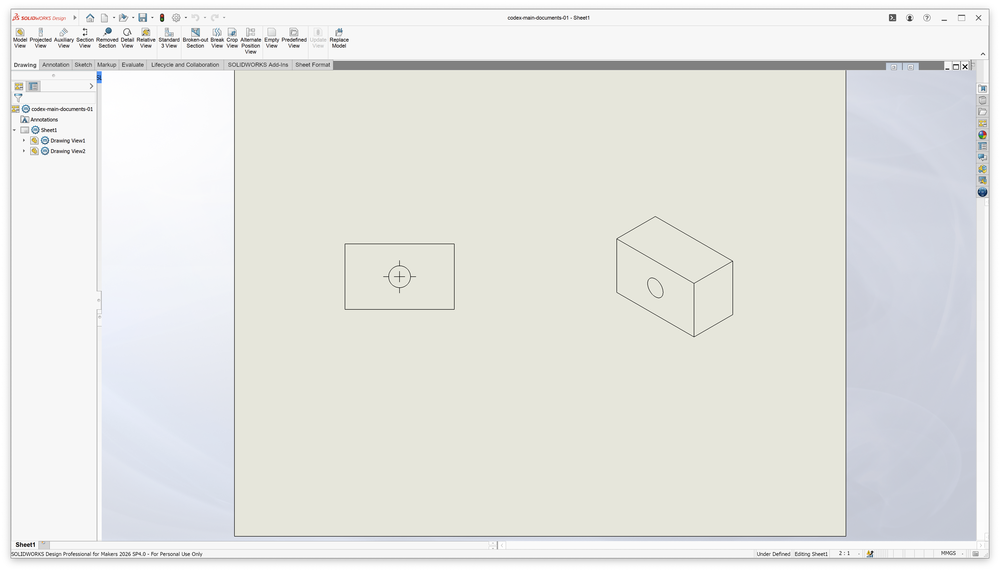
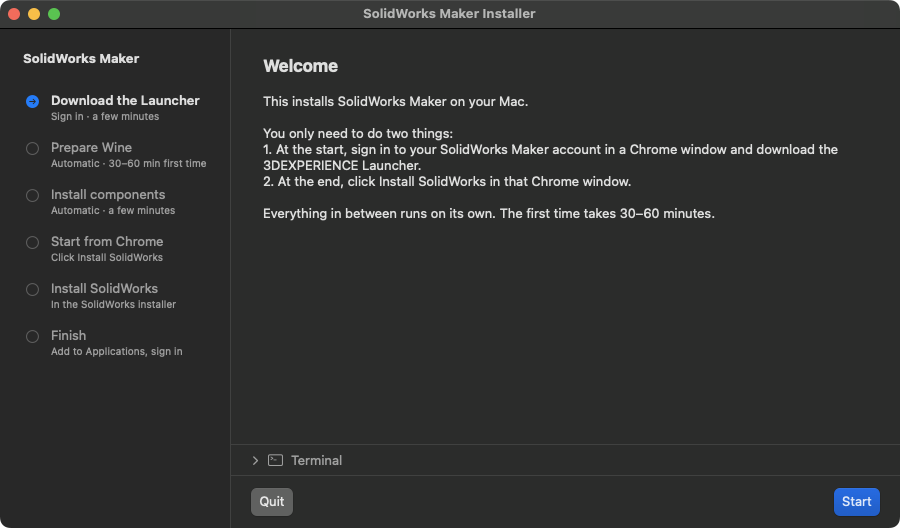

# SOLIDWORKS Maker on Mac

SOLIDWORKS for Makers on macOS with Wine.
Supports both Apple Silicon and Intel Macs.



## Install

Paste this into the Terminal:

```sh
curl -fsSL https://raw.githubusercontent.com/lazy-jubei/solidworks-maker-mac/main/install.sh -o /tmp/solidworks-maker-install.sh && zsh /tmp/solidworks-maker-install.sh
```
Sign in to your SolidWorks Maker account in the bundled Chrome window and download the
3DEXPERIENCE Launcher at the start.

After the setup, you can open **SolidWorks (Wine)** in your Applications.



## Update

Run the same [install command](#install) again. When the installer detects your
existing setup, click **Update**. Your SOLIDWORKS installation, settings and CAD
files are preserved.

To include Wine patches and browser graphics in the update, quit SOLIDWORKS and
Wine, then select **Also update Wine patches and browser graphics** in the
installer window before clicking **Update**.

## Details

The installer downloads the project, installs prerequisites, and builds a patched
Wine environment. A separate Chrome browser identifies itself as Windows so the
Makers dashboard offers the installer, without changing your usual browser.
You sign in and download SOLIDWORKS directly from Dassault Systèmes. The script
then reads your installed shortcut’s settings and creates the Mac app shortcut.

Wine 11.16 is patched to support the installer’s ZIP extraction and MSI feature
selection. bison and cabextract come from MacPorts, on Intel and Apple Silicon Macs;
the installer installs MacPorts from its notarized package if it isn't there, which
needs an administrator password once. Python and the compilers come from Apple's
Command Line Tools. On Apple Silicon, it also enables a Rosetta mode-switch workaround. On
every Mac, SolidWorks is told it runs as x64 on an ARM64 host, because its license loader
crashes under Wine on the native x64 path, Intel Macs included. A targeted mouse-capture fix
lets the feature editor’s OK/Cancel buttons receive clicks correctly. Browser graphics
libraries are scoped to the embedded browsers to support startup and reduce idle CPU use.

### Graphics performance

SolidWorks draws its 3D view with legacy OpenGL, one call per vertex. Under Wine on macOS
each call crossed into the Mac side with two system calls, which took over half of every
frame. A patched `opengl32` records simple calls and replays them in one crossing, with
identical output. The 3D view is drawn directly by the GPU and clipped so the FeatureManager,
task pane and toolbars stay visible; window images skip a color conversion. On an Intel Mac
with an RX 6900 XT, rotating a large mold assembly went from about 2.5 to about 15 redraws a
second, and a simple part from about 24 to about 70. `WINE_GL_BATCH=0` and `SW_OPENGL_GDI=1`
switch back to the older paths if something draws wrong. With more than one display, windows can
be dragged onto any of them, and menus and dialogs open on the display SolidWorks is on.

Licensed under [LGPL-2.1-or-later](LICENSE). [Third-party notices](THIRD_PARTY_NOTICES.md).
