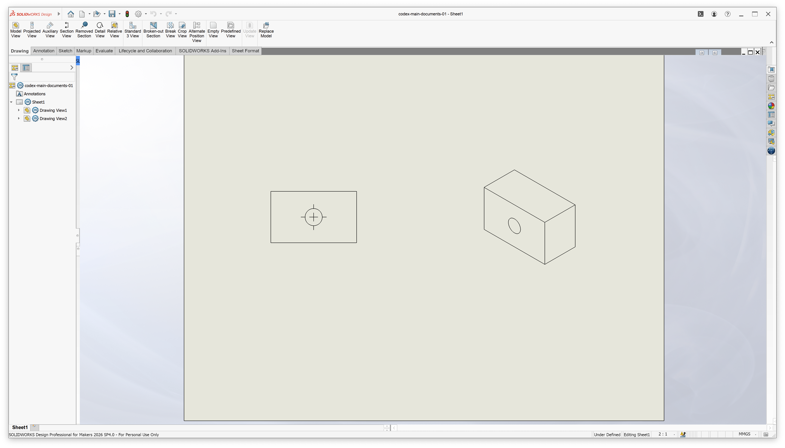

# SOLIDWORKS Maker on Mac

Run SOLIDWORKS for Makers on macOS with Wine.



## Install

Paste this into Terminal:

```sh
curl -fsSL https://raw.githubusercontent.com/lazy-jubei/solidworks-maker-mac/main/install.sh -o /tmp/solidworks-maker-install.sh && zsh /tmp/solidworks-maker-install.sh
```

Follow the prompts. The script installs prerequisites and prepares Wine, then guides
you through installing SOLIDWORKS using your own Makers subscription and signing in.

After setup, open **SolidWorks (Wine)** in your Applications folder.

## Details

The installer downloads the project, installs prerequisites, and builds a patched
Wine environment. A separate Chrome browser identifies itself as Windows so the
Makers dashboard offers the installer, without changing your usual browser.
You sign in and download SOLIDWORKS directly from Dassault Systèmes. The script
then reads your installed shortcut’s settings and creates the Mac app shortcut.

Wine 11.16 is patched to support the installer’s ZIP extraction and MSI feature
selection. Prerequisites come from Homebrew where it is available. Homebrew no longer
supports Intel Macs, so on an Intel Mac without it the installer builds bison and
cabextract from their release sources into `tools/` and uses the Command Line Tools'
Python. On Apple Silicon, it also enables a Rosetta mode-switch workaround and
corrects ARM64 host reporting during startup. An OpenGL/GDI presentation patch
fixes viewport clipping on macOS, and a targeted mouse-capture fix lets the feature
editor’s OK/Cancel buttons receive clicks correctly.

Licensed under [LGPL-2.1-or-later](LICENSE). [Third-party notices](THIRD_PARTY_NOTICES.md).
