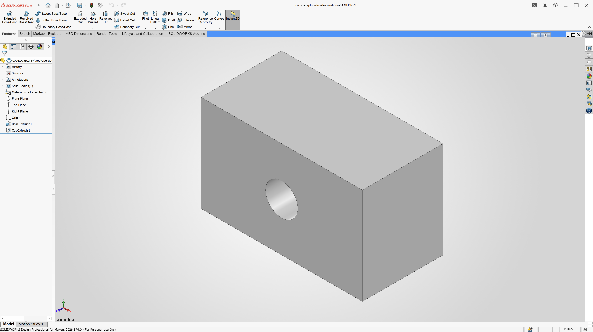

# Validation

Tests ran on Apple M4 / macOS 15.7.9, Wine Staging 11.16, SOLIDWORKS Design
Professional for Makers 2026 SP4.0, R2026x HotFix 5.9. The original development
installation and a separate clean-prefix installation were used. These results
validate those installations; they do not establish a clean installation from
this published setup kit on another Mac.

| Check | Result |
| --- | --- |
| Official clean-prefix sign-in | Passed using the normal licensed account form |
| Finder shortcut | Main launch, sign-in and startup completed |
| FeatureManager | Visible with the opt-in GDI presentation driver |
| Part modeling | Rectangle, extrusion, depth edit, circular through-cut, suppression/restore, save/reopen passed |
| Final part volume | 0.000035536504591506382 m³, matching analytical geometry |
| Interactive input | Native mouse rectangle, typed 20 mm extrusion, committed solid, save/reopen volume matched in test prefix |
| Assembly | Two components, save/reopen; combined volume 0.000071073009183012764 m³ |
| Drawing/PDF | Front and isometric views, save/reopen, PDF export; complete unclipped views verified by rendering |
| GDI diagnostic | Upright image, overlays visible, resize passed, GL state preserved |
| Intel dashboard selection | Implemented and syntax checked; hardware untested |

## Remaining limitations

- An earlier main-prefix legacy-setter dimension edit changed the parameter but
  incremental `EditRebuild3` retained the old body; a full rebuild produced the
  expected geometry. Later STA/SetSystemValue3 regressions pass with incremental
  rebuild only, but the intermittent earlier failure is not conclusively explained.
- Share-backed disk-image I/O can pause the application and helper commands.
- The native PropertyManager OK/Cancel capture failure has a scoped workaround; see
  [capture investigation](button-capture.md). Other UI commands and long-session stability need further testing.
  Earlier intermittent CEF-related document-creation crashes were not conclusively
  diagnosed, although repeated later untraced modeling checks passed.
- OpenGL-to-GDI readback costs performance. A COM rotation test is not a manual FPS
  benchmark; smooth manual interaction has not been comprehensively measured.
- The background sldProcMon process has crashed while CAD continued. The Wine crash
  dialog is disabled by the settings script.
- The Content pane can remain blank. Cloud PLM operations are unvalidated.
- First media download and end-to-end setup from this release are unverified.
  Finder auto-mount from an unmounted image is also untested.
- Complete Intel Mac CAD compatibility is untested. The architecture selection added
  for Intel applies to the dashboard Chrome launcher.
- Updates to Wine, WebView2 or SOLIDWORKS can invalidate the workarounds. The patchers
  are pinned to Wine 11.16; WebView2 may need browser-local DXMT reinstalled after updates.

Private account logs and model files are intentionally excluded from the repository.

## Setup-kit configuration checks

The old Fresh shortcut could inherit main storage/prefix values from local configuration.
The generated launcher now applies fresh selectors after reading shared account settings,
skips reloading main selectors, and refuses the main prefix/image. Functional checks run
the generated configuration code without mounting or starting Wine: custom main paths,
paths with spaces, default images, fresh isolation and collision refusal pass. The v0.1.0
builder fails the same isolation check. These checks do not establish a full
first-time installation or a Finder auto-mount test.

## Post-fix modeling check

The complete part sequence passed after the OK/Cancel fix, with STA, SetSystemValue3,
an active-document check and ordinary EditRebuild3. No ForceRebuild3 fallback ran.
The final through-cut model saved/reopened with volume 0.000035536504591506382 m³.
A separate native edit committed 70 mm with volume 0.000105 m³; native Cancel had
preserved the preceding 65 mm geometry. These results do not conclusively explain
the earlier intermittent legacy-setter automation failure.

The rebuild diagnostic also refused to run inside an active extrusion editor. The
sketch remained active afterwards, and a native Cancel restored the saved cut model
with matching volume. This prevents the previously observed diagnostic mistake of
forcing a rebuild while an extrusion preview is still pending.

## Edge features and STEP round trip

In the main installation, a copy of the saved 50 × 30 × 25 mm through-cut part
passed a 2 mm constant-radius edge fillet and a 2 mm, 45° edge chamfer, followed
by chamfer suppression/restore, incremental rebuild, native save and reopen.
Each stage matched its analytical volume within 1e-12 m³. The final native volume
was 0.000035393584224185866 m³. The fillet uses CreateDefinition/CreateFeature.

The same part passed STEP export/import, one-solid verification, native save and
reopen. Export/import/native save reported zero errors; saves reported zero
warnings. The final reopened volume was 0.000035393584224185873 m³, within the
same tolerance. These are specific regression models, not general file-format
or long-session compatibility guarantees.

The first imported-part Save As waited for a macOS Desktop-folder permission
prompt. After the user allowed it, the same running operation completed and the
part reopened with matching volume; no CAD/server restart was needed. A second
native save of the more complex import completed in about 1.7 seconds. Do not
treat time spent waiting for an unanswered OS prompt as CAD save performance.

See [reproducing the CAD checks](cad-checks.md).

## Assembly editing and drawing export

In the same main CAD session after about three hours of uptime, the filleted and
chamfered part passed two-instance assembly creation/save/reopen and drawing
creation with front/isometric views, drawing save/reopen and PDF export. The
combined volume was 0.000070787168448371745 m³. Rendering the one-page landscape
Letter PDF showed both complete, unclipped views and the Makers footer. These
document-creation calls ran without a debugger; no CEF crash occurred in this run.

A separate assembly copy then passed a 20 mm component move, fixed/floating state
checks, a 40 mm distance mate, component suppression/restore, incremental rebuild,
native save/reopen, transform checks and mate persistence. Suppression halved the
volume as expected; restore and reopen recovered the original combined volume.
The initial test client incorrectly expected mate status zero; it was corrected
to the documented success enum (1), and the complete sequence passed on a new
copy. That initial refusal was not a CAD failure.

The distance mate was then edited from 40 to 60 mm using native mouse/keyboard
input, including the ordinary PropertyManager green confirmation. Exiting the
subsequent empty Mate tool retained the committed value. After saving and reopening,
the mate dimension was 0.06 m and the two component Z translations differed by
0.06 m. The saved assembly was clean. This tests another native confirmation path
with the existing capture guard; no new Wine module change was required.

## Revolve and body-pattern checks

The standard New Document dialog opened and a native click created a blank part
in the same running CAD session. A 360-degree revolve produced one hollow cylinder
with volume 0.000028274333882308141 m³, matching a 20/10 mm radius, 30 mm long ring.

A new blank part then passed the complete revolve/body-pattern sequence: three
equal-volume bodies with X centres at 0, 60 and 120 mm, undo back to one body,
redo to three, pattern suppression/restore, ordinary incremental rebuild, native
save and reopen. Final combined volume was 0.000084823001646924416 m³. Save errors
and warnings were zero.

The first late-bound test attempted to assign the direction/body object properties
of a standalone pattern definition and got no feature. Using the documented marked
preselection route created the correct pattern. Getters on the standalone definition
still showed no references before creation, so those getters alone do not establish
whether preselection will work. No Wine patch was introduced for this client setup.

The pattern count was then edited 3->4 with native mouse/keyboard input and green
confirmation; the editor closed and the feature tree showed four solid bodies.
Native Windows Ctrl+Z restored count 3, and Ctrl+Y restored count 4. Read-only checks
verified the feature parameter, individual volumes and centres after each operation.
After native zoom-to-fit, save/reopen retained four bodies at X=0/60/120/180 mm,
combined volume 0.00011309733552923255 m³, with no unsaved changes. Manual viewport
FPS was not measured. Command-key checks are recorded separately below.

## Clean quit and shortcut relaunch

After all 11 open documents were confirmed clean, the normal CAD exit completed
and its background monitor exited with it. The Mac app shortcut started a new CAD
process and monitor, with StartupProcessCompleted and UserControl both true.
The existing four-body part reopened with its expected volume. A native click in
the standard New Document dialog then created a blank part, and the current
revolve helper passed its complete three-body pattern, undo/redo, suppression,
incremental rebuild and save/reopen sequence in this fresh session. This run also
exercised the helper's active-document guards before undo, redo and rebuild.

The Welcome window's News panel was blank; closing it allowed CAD work to proceed.
A source read from the network share and the launcher both paused during startup,
then recovered without restarting Wine. That is evidence of storage latency, not
a diagnosis of every pause. The disk image remained mounted throughout this test;
Finder auto-mount from an unmounted image remains untested.

## Shell checks

A new blank part passed a 50 × 30 × 25 mm solid-box extrusion, 2 mm inward shell
with one face removed, thickness edit to 3 mm, suppression/restore, ordinary
incremental rebuild and save/reopen. The reopened 3 mm shell volume was
0.000014268000000000003 m³, matching the analytical open-box volume, and the
feature definition retained 0.003 m thickness. Saves reported zero errors and
warnings. The new shell helper is included in `build-cad-checks.sh`.

A native PropertyManager edit then changed 3 mm to 4 mm using numeric input,
Tab and green confirmation. Read-only checks confirmed thickness and volume
(0.000018096 m³), and the part saved clean. Reopening the editor, entering 5 mm
and clicking native Cancel retained the 4 mm thickness and volume. The document
was nevertheless marked modified after Cancel; this is an observation without
a Windows comparison establishing whether it is Wine-specific. The reopen guard
refused the dirty document, so it was explicitly saved before the final reopen.
That reopen retained 4 mm walls, the expected volume, and a clean document flag.
The native window capture showed the open cavity and Shell1 in the feature tree.
The updated build script compiled all five helpers successfully; the shell helper
also refused an existing output path before attaching to CAD.

## Part configuration checks

A separate copy of the baseline cut part passed creation of `CodexTall`, a
configuration-specific extrusion-depth edit from 25 to 40 mm, repeated switching,
and cut suppression confined to CodexTall. The original configuration retained
its 25 mm depth and hole. Both dimensions and analytical volumes matched after
ordinary incremental rebuild and save/reopen: Default volume
0.000035536504591506382 m³, CodexTall volume 0.000056858407346410207 m³. Suppressing
the cut in CodexTall produced the expected 0.00006 m³ solid; restoring it recovered
the hole. Saves reported zero errors and warnings. No full-rebuild fallback ran.

The initial test client treated a redundant ShowConfiguration2 call as a failure
after AddConfiguration2 had already activated CodexTall. Read-only inspection
confirmed the requested configuration was active; the helper now avoids that
redundant switch and verifies the resulting active name. The corrected complete
sequence passed on a new copy. This was a client assertion issue, not a CAD crash.

Native double-clicks in ConfigurationManager then switched to Default and back
to CodexTall. Read-only inspection confirmed the expected configuration, depth
and volume after each click; both configuration states were clean. The rendered model
and ConfigurationManager check mark were inspected. The public build script
compiled all six helpers, and the configuration helper refused an existing output
before attaching to CAD.

## Repeated incremental rebuild investigation

Four separate saved copies of the baseline cut part each passed ten depth edits:
STA and MTA clients, each using the legacy SystemValue setter and current
SetSystemValue3 setter. Depths varied from 21 to 50 mm and ended at 25 mm.
Every edit used only ordinary EditRebuild3, with no full-rebuild call or fallback.
Both solid-body and mass-property volumes matched analytical geometry after all
40 edits; the largest absolute volume error was 2.71e-20 m³, within the 1e-12 m³
tolerance. Rebuild-needed flags were clear after every measured rebuild, and all
four copies saved/reopened correctly with zero save errors or warnings.

These repeated saved-part runs did not reproduce the earlier intermittent stale
body. They do not establish its cause or prove it fixed. The older fresh-part
comparison used a full rebuild between setter tests; this diagnostic deliberately
omits it. `SwDimensionCycles` is included in the optional CAD helper build so this
specific behavior can be checked again without masking a failure.

## STL export checks

The saved baseline cut-box part exported as binary STL in millimetres with zero
errors and warnings. The source retained its original path and clean flag, and
the previous export preferences were verified afterward. The first helper attempt
stopped before export on a false return from setting an already-selected format;
it now skips unchanged settings and verifies preference readback instead.

Independent parsing found 168 triangles, 84 vertices, exactly 50 × 30 × 25 mm
bounds, closed edges, consistent winding, one connected surface, and Euler
characteristic zero (the expected through-hole topology). Signed volume was
35545.7371 mm³ versus the exact 35536.5046 mm³: approximately 0.026% difference,
within the diagnostic's 0.5% tessellation tolerance. No resolution preference was
changed. This verifies the exported fixture, not general printability or a physical
print. Negative controls made from the actual export correctly rejected an open
mesh, a 1000× scale error and inconsistent triangle winding.

## Native viewport navigation

Native middle-button rotation, Ctrl+middle pan, Shift+middle zoom and F zoom-to-fit
passed on the saved cut-box part. Read-only view snapshots confirmed rotation
changed orientation, pan changed translation without rotation or scaling, and zoom
changed scale without rotation. Solid volume stayed 0.000035536504591506382 m³
and the document remained clean. The final fitted model and FeatureManager were
visually complete, with no new CAD crash.

The private input helper needed actual modifier-key events for pan/zoom. Its first
release implementation left native Shift state behind, which a later plain key
inherited. It now sends native modifier-change releases through the same event
path as the drag and explicitly clears flags on plain keys. Repeated pan/zoom and
the subsequent F action passed; both macOS modifier state and Wine's Shift,
Control and middle-button state were released. This was a test-helper correction;
no Wine runtime patch was needed. These are functional input checks, not a frame-rate
or physical smoothness benchmark.

## Native Hole Wizard

On a separate saved cut-box copy, the native Hole Wizard toolbar command loaded
the ANSI Inch standard, hole types and sizes. The Positions tab entered its sketch,
a native click placed one hole away from the existing cut, and normal green
confirmation created a HoleWzd counterbore feature.

The ANSI Inch #00 binding-head selection produced a 1.397 mm through-hole,
3.175 mm counterbore diameter and 0.7112 mm counterbore depth. Read-only feature
inspection and analytical removed-volume checks agreed. Saving reported zero
errors and warnings; reopening retained the feature, dimensions and clean flag,
with volume 0.000035493644171874541 m³. The database and confirmation paths worked
without another Wine patch or a CAD crash. This verifies that specific hole type
and standard, not all Hole Wizard options or Toolbox component insertion.

## Mac Command shortcuts

With the existing LeftCommandIsCtrl setting enabled, native left Command+Z and
Command+Y undid and redid a pattern-count edit on a separate saved part copy.
Native PropertyManager input changed four bodies to five; Command+Z restored
four with the original volume, and Command+Y restored five. Read-only inspection
checked the feature count, individual body volumes and 60 mm spacing after each
action. Native Command+S then saved the local part and cleared its modified flag.
Reopening retained five bodies and volume 0.00014137166941154071 m³.

The fitted viewport showed all five bodies. Native Command/Control/Shift state
and Wine's navigation-key state were released after the checks. No new runtime
patch was needed, and no CAD crash occurred. This check used left Command with the Windows
undo/redo bindings; it does not establish other shortcut mappings.

## Setup storage guards

The original storage script accepted any existing mount directory, even if it
belonged to another image, and did not verify the result of an attachment. It now
checks hdiutil's backing-image/mount-point pair, requests the configured mount
point explicitly, and checks it again before creating Wine directories.

Simulated storage checks passed for a correct existing mount, a fresh image,
paths with spaces and image aliases. They refused an ordinary folder, another
image at the requested mount, an image attached elsewhere, invalid inventory and
an incorrect post-attach result. Existing sentinel files were preserved. In the
live development environment, the public checkout's default image differed from
the already-mounted development image: storage preparation correctly refused
before creating an image or cache, while the actual development image was
recognized as mounted. No live mount or CAD process was changed. The simulated
checks do not establish a complete fresh installation from the published kit.
