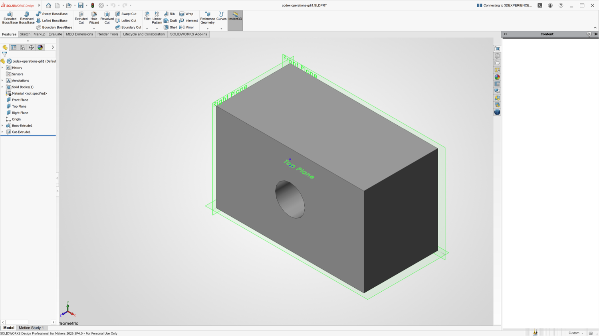

# Validation for v0.1.0

Tests ran on Apple M4 / macOS 15.7.9, Wine Staging 11.16, SOLIDWORKS Design
Professional for Makers 2026 SP4.0, R2026x HotFix 5.9. The original development
installation and a separate clean-prefix installation were used. These results
validate those installations; they do not establish a clean installation from
this published setup kit on another Mac.

| Check | Result |
| --- | --- |
| Official clean-prefix sign-in | Passed using the normal licensed account form |
| Finder shortcut | Main launch, sign-in and startup completed |
| FeatureManager | Visible with the opt-in GDI presentation driver |
| Part modeling | Rectangle, extrusion, depth edit, circular through-cut, suppression/restore, save/reopen passed |
| Final part volume | 0.000035536504591506382 m³, matching analytical geometry |
| Interactive input | Native mouse rectangle, typed 20 mm extrusion, committed solid, save/reopen volume matched in test prefix |
| Assembly | Two components, save/reopen; combined volume 0.000071073009183012764 m³ |
| Drawing/PDF | Front and isometric views, save/reopen, PDF export; complete unclipped views verified by rendering |
| GDI diagnostic | Upright image, overlays visible, resize passed, GL state preserved |
| Intel dashboard selection | Implemented and syntax checked; hardware untested |

## Remaining limitations

- A main-prefix dimension edit changed the parameter but incremental `EditRebuild3`
  retained the old body. `ForceRebuild3(False)` produced the expected geometry.
  Use a full rebuild (Ctrl+Q; the setup maps Cmd to Ctrl) if an edit appears stale.
  The regression explicitly performs that full rebuild and checks the resulting volume.
- Share-backed disk-image I/O can pause the application and helper commands.
- Ordinary UI confirmation timing and long-session stability need further testing.
  Earlier intermittent CEF-related document-creation crashes were not conclusively
  diagnosed, although repeated later untraced modeling checks passed.
- OpenGL-to-GDI readback costs performance. A COM rotation test is not a manual FPS
  benchmark; smooth manual interaction has not been comprehensively measured.
- The background sldProcMon process has crashed while CAD continued. The Wine crash
  dialog is disabled by the settings script.
- The Content pane can remain blank. Cloud PLM operations are unvalidated.
- First media download and end-to-end setup from this release are unverified.
  Finder auto-mount from an unmounted image is also untested.
- Complete Intel Mac CAD compatibility is untested. The architecture selection added
  for Intel applies to the dashboard Chrome launcher.
- Updates to Wine, WebView2 or SOLIDWORKS can invalidate the workarounds. The patchers
  are pinned to Wine 11.16; WebView2 may need browser-local DXMT reinstalled after updates.

Private account logs and model files are intentionally excluded from the repository.
